# Terra — Open-Source Geospatial Analysis & 3D Terrain Platform

[](https://github.com/username/terra/actions/workflows/ci.yml)
[](https://github.com/username/terra/actions/workflows/deploy.yml)
[](https://www.typescriptlang.org/)
[](LICENSE)
[](#architecture--technology-stack)

**Terra** is a modern, high-performance, browser-based geospatial analysis and 3D terrain exploration engine. It empowers hydrologists, environmental scientists, cartographers, and geospatial engineers to analyze Digital Elevation Models (DEMs), evaluate topographic derivatives, route hydrological flow networks, delineate contributing watersheds, and generate cross-sectional elevation profiles—all completely within the browser using WebGL and multi-threaded Web Workers.

Terra requires **no servers, no backend processing, no cloud APIs, and no paid subscriptions**.

---

## Architecture Overview

```mermaid
flowchart TD
    subgraph Input["Data Ingestion"]
        GT["Client-Side GeoTIFF Loader<br/>(geotiff.js)"]
        SYN["Synthetic Terrain Generators<br/>(Mountain, Valley, Pyramid)"]
        SMP["Open Curated DEMs<br/>(Mount St. Helens, Eagle Creek)"]
    end

    subgraph DataModel["Core Geospatial Model"]
        EG["ElevationGrid (Float32Array)<br/>6-Param Affine Transform & CRS"]
        MM["Memory Bounding & Decimation<br/>LOD Vertex Stride Budget"]
    end

    subgraph Workers["Multi-Threaded Web Worker Pipeline"]
        W1["derivatives.worker.ts<br/>Fused Single-Pass Horn Slope, Aspect, Hillshade"]
        W2["priority-flood.worker.ts<br/>Barnes Min-Heap Depression Filling"]
        W3["hydrology.worker.ts<br/>D8 Flow Routing & In-Degree Topological Accumulation"]
    end

    subgraph Viewport["Graphics & Visualization Engine"]
        T3["Three.js WebGL Engine<br/>Adaptive BufferGeometry LOD (≤1M Vertices)"]
        BL["Cartographic Layer Blending<br/>(Multiply, Normal, Overlay)"]
        ST["3D Vector Stream Drape & Watershed Masking"]
    end

    subgraph Workspace["Analysis & Export Workspace"]
        HUD["Real-Time Inspection HUD (60 FPS)"]
        PRF["2D Bilinear Profile Transects"]
        EXP["Client-Side Geospatial Export<br/>(32-bit Float GeoTIFF, GeoJSON, PNG, CSV)"]
    end

    Input --> DataModel
    DataModel --> Workers
    Workers -- Zero-Copy Transferable Buffers --> Viewport
    Viewport --> Workspace
```



---

## Milestone Feature Matrix

| Capability | Milestone | Status | Key Algorithms & Implementation Details |
| :--- | :---: | :---: | :--- |
| **Elevation Grid Data Model** | M1 | ✅ Production | Typed `Float32Array`, 6-parameter affine transform, NoData sentinel handling, statistics. |
| **GeoTIFF Ingestion** | M1 | ✅ Production | In-browser parsing of raster strips, ModelPixelScale, ModelTiepoint, GeoKeyDirectory tags. |
| **3D WebGL Terrain Viewer** | M1 | ✅ Production | Three.js `BufferGeometry`, orbit controls, vertical exaggeration (0.1×–5×), wireframe toggle. |
| **Topographic Slope** | M2 | ✅ Production | Horn's (1981) 3×3 weighted finite-differences in degrees and gradient percentage. |
| **Directional Aspect** | M2 | ✅ Production | Circular downslope azimuth ($0^\circ–360^\circ$), flat detection ($-1$), circular mean statistics. |
| **Analytical Hillshade** | M2 | ✅ Production | Lambertian diffuse reflectance illumination with interactive solar azimuth and altitude. |
| **Perceptually Uniform Color Ramps** | M2 | ✅ Production | Topographic, slope warning, cyclic aspect, grayscale hillshade, and logarithmic accumulation palettes. |
| **Sink Preprocessing (Priority-Flood)** | M3 | ✅ Production | Barnes et al. (2014) $O(N \log N)$ typed min-heap depression filling with flat-resolving $\epsilon$-gradient. |
| **D8 Flow Direction Routing** | M3 | ✅ Production | O'Callaghan & Mark (1984) metric distance weighting with deterministic tie-breaking. |
| **Flow Accumulation** | M3 | ✅ Production | In-degree topological sort ($O(N)$ acyclic execution) with linear and $\log_{10}$ hypsometric scaling. |
| **Stream Extraction & 3D Vector Drape** | M3 | ✅ Production | Threshold-based stream network extraction rendered as floating 3D vector polylines. |
| **Interactive Watershed Delineation** | M3 | ✅ Production | Click-to-inspect pour points, reverse-BFS basin boundary extraction, and basin area ($\text{km}^2$). |
| **Elevation Profile Transects** | M4 | ✅ Production | Bilinear cross-section sampling along user-drawn transects with interactive SVG profile graph. |
| **Multi-Layer Cartographic Blending** | M4 | ✅ Production | Normal, Multiply, and Overlay blending of shaded relief with slope, aspect, and flow accumulation. |
| **Camera Bookmark Presets** | M4 | ✅ Production | Instant 2D top-down map, 45° isometric, and low-angle oblique perspective views. |
| **Client-Side Export Suite** | M4 | ✅ Production | 32-bit float GeoTIFF raster, GeoJSON streams/watersheds, annotated viewport PNG, and profile CSV. |
| **Web Worker Compute Pipeline** | M5 | ✅ Production | Dedicated background workers with zero-copy `ArrayBuffer` transfer lists and progress reporting. |
| **Adaptive Geometry LOD** | M5 | ✅ Production | Dynamically subsampled mesh geometry bounded to $\le 1,000,000$ vertices; invariant $(0 \to 1)$ UVs. |
| **Raster Memory Bounding** | M5 | ✅ Production | Memory estimator and crash guardrails for rasters $>4.2\text{M}$ cells with structured decimation. |
| **Automated Benchmark Suite** | M5 | ✅ Production | Vitest micro-benchmarks reporting cell throughput ($Mcells/s$) across grid sizes up to $2048 \times 2048$. |
| **Architectural Documentation** | M6 | ✅ Production | Deep-dive mathematical, CRS, and graphics specification in [`docs/architecture.md`](docs/architecture.md). |
| **Open Sample DEM Datasets** | M6 | ✅ Production | USGS Mount St. Helens (30m UTM) and Copernicus Drainage Basin (30m UTM) with open licenses. |
| **Automated CI/CD Workflows** | M6 | ✅ Production | GitHub Actions multi-job CI (typecheck, lint, unit tests, benchmarks, static build). |
| **End-to-End Browser Testing** | M6 | ✅ Production | Headless Playwright test suite validating WebGL canvas, DEM loading, layers, presets, and transects. |
| **Static Production Optimization** | M6 | ✅ Production | Optimized chunk splitting (`vendor-three`, `vendor-react`, `vendor-geotiff`) and GitHub Pages deployment. |

---

## Open Sample Datasets

Terra provides authentic georeferenced DEM datasets for instant single-click exploration directly in the sidebar:

1. **Mount St. Helens Volcanic Peak (`mount_st_helens.tif`)**:
   - **Source**: USGS 3D Elevation Program (3DEP).
   - **CRS**: WGS 84 / UTM Zone 10N (EPSG:32610), metric meter spacing.
   - **Characteristics**: $128 \times 128$ raster (30m resolution), post-1980 horseshoe collapse caldera, central dacite lava dome, and northern avalanche breach (relief: 1,050m to 2,549m).
   - **License**: Public Domain (U.S. Government Work).

2. **Eagle Creek Dendritic Drainage Basin (`drainage_basin.tif`)**:
   - **Source**: Copernicus DEM (GLO-30) / ESA Open Access.
   - **CRS**: WGS 84 / UTM Zone 11N (EPSG:32611), metric meter spacing.
   - **Characteristics**: $128 \times 128$ raster (30m resolution), dendritic stream valleys, steep cirque ridges, and natural upland depressions/sinks to test Barnes Priority-Flood and flow accumulation.
   - **License**: Creative Commons Attribution 4.0 International (CC BY 4.0).

3. **Sample Volcanic Peak (`sample_dem.tif`)**:
   - **Characteristics**: Lightweight $35 \times 35$ grid for rapid verification and smoke tests.

*Full dataset metadata and licensing are documented in [`public/samples/README.md`](public/samples/README.md).*

---

## Empirical Algorithmic Performance

Benchmarked on modern hardware (AMD Ryzen / Apple Silicon) using multi-threaded Web Workers:

| Algorithm | Grid Dimensions | Total Cells | Latency (ms) | Throughput (Mcells/s) |
| :--- | :---: | :---: | :---: | :---: |
| **Horn's Slope** | $512 \times 512$ | 262,144 | ~20 ms | **~13.3 Mcells/s** |
| **Horn's Slope** | $1024 \times 1024$ | 1,048,576 | ~69 ms | **~15.3 Mcells/s** |
| **Horn's Slope** | $2048 \times 2048$ | 4,194,304 | ~262 ms | **~16.0 Mcells/s** |
| **Priority-Flood Filling** | $256 \times 256$ | 65,536 | ~10 ms | **~6.2 Mcells/s** |
| **Priority-Flood Filling** | $512 \times 512$ | 262,144 | ~42 ms | **~6.2 Mcells/s** |
| **Priority-Flood Filling** | $1024 \times 1024$ | 1,048,576 | ~169 ms | **~6.2 Mcells/s** |
| **D8 Flow Accumulation** | $512 \times 512$ | 262,144 | ~17 ms | **~15.6 Mcells/s** |
| **D8 Flow Accumulation** | $1024 \times 1024$ | 1,048,576 | ~69 ms | **~15.1 Mcells/s** |

---

## Local Development & Verification

### Prerequisites
- Node.js (v20+ or v22+ recommended)
- npm

### Installation
```bash
git clone https://github.com/username/terra.git
cd terra
npm install
```

### Development Server
```bash
npm run dev
```

### Comprehensive Quality Checks
```bash
# TypeScript strict type checking
npm run typecheck

# ESLint code style verification
npm run lint

# Automated unit test suite (Vitest, 85 tests)
npm run test

# Algorithmic throughput benchmarks
npm run bench

# Playwright browser end-to-end tests (headless Chromium)
npm run test:e2e

# Production static build with chunk optimization
npm run build
```

---

## Documentation Links

- [Architectural Specification & Mathematical Derivations (`docs/architecture.md`)](docs/architecture.md)
- [Sample DEM Datasets & Licensing (`public/samples/README.md`)](public/samples/README.md)
- [Development Progress Log (`PROGRESS.md`)](PROGRESS.md)

---

## License

Terra is open-source software licensed under the [MIT License](LICENSE).
